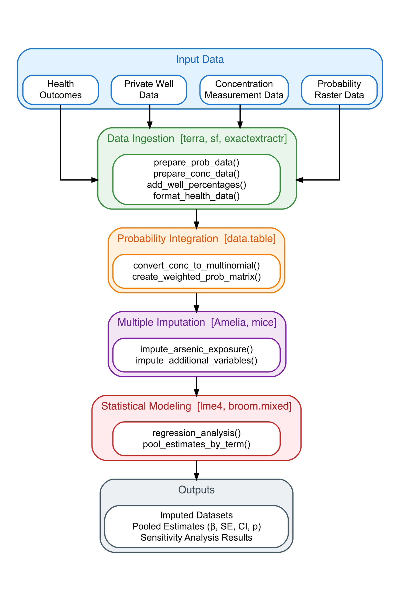

# geoExposeR
An R package for modeling health effects of environmental exposures, with a primary focus on groundwater contaminants. Based on epidemiological studies and existing concentration models.

<!-- Package Info -->
[](https://code.usgs.gov/envirohealth/geoExposeR)
[](https://www.r-project.org/)
[](https://creativecommons.org/publicdomain/zero/1.0/)

<!-- Build Status -->
[](https://code.usgs.gov/envirohealth/geoExposeR/-/pipelines)

<!-- Quality Metrics -->
[](https://code.usgs.gov/envirohealth/geoExposeR/-/commits/main)

<!-- Documentation and Usage -->
[](https://envirohealth.code-pages.usgs.gov/geoExposeR/)
[](https://envirohealth.code-pages.usgs.gov/geoExposeR/articles/)
[](https://code.usgs.gov/envirohealth/geoExposeR/)

<!-- Development Status -->
[](https://www.repostatus.org/#active)
[](https://lifecycle.r-lib.org/articles/stages.html#stable)

<!-- Code Quality -->
[](https://style.tidyverse.org)
[](https://code.usgs.gov/envirohealth/geoExposeR/blob/main/DESCRIPTION)

<!-- Academic -->
[](https://code.usgs.gov/envirohealth/geoExposeR)
<!-- [](https://joss.theoj.org/papers/10.21105/joss.XXXXX) -->

<!-- USGS Software Release -->
**USGS IPDS Record Number:** IP-XXXXXX *(To be updated after USGS software release approval)*

**Principal Investigator**: [Dr. Matthew O. Gribble](https://profiles.ucsf.edu/matthew.gribble) [matt.gribble@ucsf.edu]

**Co-Investigators**: [Dr. Sayantan Majumdar](https://www.dri.edu/directory/sayantan-majumdar/) [sayantan.majumdar@dri.edu], [Dr. Ryan G. Smith](https://www.engr.colostate.edu/ce/people/ryan-smith/) [ryan.g.smith@colostate.edu]

## Citation

If you use geoExposeR in your research, please cite:

> Majumdar, S., Bartell, S. M., Lombard, M. A., Smith, R. G., & Gribble, M. O. (2026). 
> geoExposeR: An R package for modeling health effects of environmental exposures. 
> *Journal of Open Source Software* (under review).

**BibTeX:**
```bibtex
@article{majumdar2026gwarsenic,
  title={geoExposeR: An R package for modeling health effects of environmental exposures},
  author={Majumdar, Sayantan and Bartell, Scott M and Lombard, Melissa A and Smith, Ryan G and Gribble, Matthew O},
  journal={Journal of Open Source Software},
  year={2026},
  note={Under review},
  url={https://code.usgs.gov/envirohealth/geoExposeR}
}
```

**DOI:** *Coming soon upon publication in JOSS*

## Table of Contents
- [Statement of Need](#statement-of-need)
- [Workflow](#workflow)
- [Installation](#installation)
- [Quick Start](#quick-start)
- [Examples](#examples)
- [Package Structure](#package-structure)
- [Core Functions](#core-functions)
- [Key Features](#key-features)
- [Documentation](#documentation)
- [Data Requirements](#data-requirements)
- [Data Preparation Workflow](#data-preparation-workflow)
- [Running Tests](#running-tests)
- [Modifying the R Package](#modifying-the-r-package)
- [Contributing](#contributing)
- [Troubleshooting](#troubleshooting)
- [License](#license)

## Statement of Need

geoExposeR is an R package that provides a streamlined workflow for epidemiologists and public health researchers to estimate arsenic exposure from private and public well water and to assess its association with various health outcomes. The package implements a sophisticated statistical approach that combines geospatial arsenic prediction models with a multiple imputation framework to account for exposure uncertainty. The core functionality integrates predicted arsenic concentration probabilities from U.S. Geological Survey (USGS) models for private wells with U.S. Environmental Protection Agency (EPA) data for public water systems. It then uses a weighting scheme based on the proportion of the population served by each water source to create a unified, county-level exposure probability distribution. By encapsulating these complex methodologies into a single, user-friendly function, geoExposeR makes this type of analysis more accessible, reproducible, and standardized.

**While designed for drinking water arsenic exposure assessments, the underlying statistical framework is broadly applicable to other environmental contaminants** (nitrate, uranium, manganese, PFAS) and air pollutants (PM2.5, ozone) where spatially-predicted exposure probabilities and health outcome data are available. See the [Broader Applicability](#broader-applicability) section and example scripts for guidance on adapting the package to other domains.

## Workflow

The figure below illustrates the complete analytical workflow implemented in geoExposeR. The pipeline integrates four input data sources through data ingestion, probability integration, multiple imputation, and statistical modeling stages to produce pooled estimates with proper uncertainty quantification.

<p align="center">
  
</p>

<p align="center"><em>geoExposeR analytical workflow showing the data processing pipeline from input sources through statistical modeling to pooled estimates. Packages used at each stage are indicated in brackets. Pooled estimates include regression coefficients (β), standard errors (SE), 95% confidence intervals (CI), and p-values, all computed using Rubin's Rules.</em></p>

### Key Capabilities

| Category | Features |
|----------|----------|
| **Data Ingestion** | Process GeoTIFF rasters, EPA measurements, health data; geographic subsetting; input validation |
| **Exposure Modeling** | USGS/EPA probability integration; population-weighted averaging; lognormal parameter estimation |
| **Statistical Analysis** | Multiple imputation (MICE); mixed-effects regression; Rubin's Rules pooling |
| **Quality Assurance** | 100% test coverage; comprehensive input validation; reproducible workflows |

Existing methods from studies like _Bulka et al. (2022)_ and _Lombard et al. (2021)_ provide robust statistical frameworks but require complex implementation involving:
- Integration of multiple probabilistic models (USGS and EPA)
- Multiple imputation techniques for uncertain exposures
- Mixed-effects regression with proper pooling of results

**geoExposeR solves this** by packaging these sophisticated methods into user-friendly functions. This enables researchers to:

- 🔬 **Focus on science**, not statistical programming
- 📊 **Ensure reproducibility** across studies  
- ⚡ **Accelerate research** on arsenic health effects
- 🎯 **Apply best practices** for uncertainty quantification
- 🗺️ **Work with multiple data formats** (GeoTIFF, CSV, shapefiles)

By democratizing access to these methods, geoExposeR promotes more rigorous and comparable arsenic exposure research.

## Installation
### System Dependencies: Pandoc

To build the package vignettes, which provide detailed documentation and examples, you need to have Pandoc installed. RStudio bundles a version of Pandoc, so if you are an RStudio user, you may not need to install it separately.

If you do not have Pandoc, you can download and install it from the official website: [pandoc.org/installing.html](https://pandoc.org/installing.html).

### R Package Installation

**Prerequisites:** R (≥ 4.4.0) and [Pandoc](https://pandoc.org/installing.html) for building vignettes.

**Install from USGS GitLab:**

> **Note:** Installation using `devtools::install_gitlab()` does not currently work while the repository is private. It will work after the repository is approved and publicly available, with the `ref` argument pointing to a tagged release version.

```r
# Install devtools if not already installed
if (!require("devtools")) install.packages("devtools")

# Install geoExposeR from USGS GitLab (specific tag or branch)
devtools::install_gitlab(
  repo = "envirohealth/geoExposeR@v1.0.0",  # Replace with desired tag or branch
  host = "code.usgs.gov",
  build_vignettes = TRUE
)

# Load the package
library(geoExposeR)
```

**For development and testing (includes coverage tools):**
```r
# Install additional development dependencies
install.packages(c("devtools", "testthat", "covr", "DT", "htmltools"))

# Install geoExposeR from USGS GitLab (specific tag or branch)
devtools::install_gitlab(
  repo = "envirohealth/geoExposeR@main",  # Or use a specific tag like @v1.0.0
  host = "code.usgs.gov",
  build_vignettes = TRUE
)
```

**Verify installation:**
```r
# Check package version
packageVersion("geoExposeR")

# View help
?perform_sensitivity_analysis
```

**Package Documentation Website:**

The complete package documentation, including detailed function references, vignettes, and examples, is available at: **https://envirohealth.code-pages.usgs.gov/geoExposeR/**

This website is automatically generated and updated whenever changes are made to the main branch, ensuring you always have access to the latest documentation.

### Local Installation from Downloaded ZIP

If you downloaded the repository as a ZIP file (e.g., from GitLab or GitHub), you can install the package locally:

1. **Extract the ZIP file** to a directory of your choice.

2. **Install from the extracted folder:**

```r
# Install devtools if not already installed
if (!require("devtools")) install.packages("devtools")

# Install from the local directory
# Replace the path with the actual path to the extracted folder
devtools::install_local(
  path = "/path/to/geoExposeR",  # Path to the extracted package folder
  build_vignettes = TRUE,
  dependencies = TRUE
)

# Load the package
library(geoExposeR)
```

**Alternative: Install from the ZIP file directly (without extracting):**

```r
# Install directly from the ZIP file
devtools::install_local(
  path = "/path/to/geoExposeR.zip",  # Path to the downloaded ZIP file
  build_vignettes = TRUE,
  dependencies = TRUE
)
```

**Using RStudio:**

You can also install the package using RStudio's GUI:
1. Go to **Tools > Install Packages...**
2. In the "Install from:" dropdown, select **Package Archive File (.zip; .tar.gz)**
3. Click **Browse** and navigate to the downloaded ZIP or tarball file
4. Click **Install**

> **Note:** Building vignettes requires [Pandoc](https://pandoc.org/installing.html). If you encounter issues, you can skip vignette building by setting `build_vignettes = FALSE`.

### Modifying the R Package
If you want to customize this package, run the following using R after you have modified the codes.
```
# Set the working directory to your package directory
setwd(<path to geoExposeR>)

# Load devtools
library(devtools)

# Generate documentation
document()

# Build the package
build()

# Install the package
install()
```

## Quick Start

```r
library(geoExposeR)

# Run sensitivity analysis with your data
results <- perform_sensitivity_analysis(
  ndraws = 10,
  as_usgs_prob_csv = "path/to/usgs_data.csv",
  as_epa_prob_csv = "path/to/epa_data.csv", 
  birth_data_txt = "path/to/birth_data.txt",
  regression_formula = "~ AsLevel + MAGE_R + rural + (1|FIPS)",
  output_dir = "results/",
  targets = c("OEGEST", "BWT")
)

# View results
print(results)
```

**Using Raw Concentration Data**

If your EPA data contains raw arsenic concentrations instead of pre-calculated lognormal parameters, specify the concentration column and the package will automatically convert them:

```r
results <- perform_sensitivity_analysis(
  ndraws = 10,
  as_usgs_prob_csv = "path/to/usgs_data.csv",
  as_epa_prob_csv = "path/to/epa_raw.csv",     # File with raw concentrations
  epa_as_conc_col = "arsenic_concentration",   # Column with raw values
  epa_default_sdlog = 1.0,                      # Default sdlog value
  birth_data_txt = "path/to/birth_data.txt",
  regression_formula = "~ AsLevel + MAGE_R + rural + (1|FIPS)",
  output_dir = "results/",
  targets = c("OEGEST", "BWT")
)
```

For detailed examples with dummy data, see the [vignette](vignettes/geoExposeR-vignette.Rmd).

## Examples

The package includes multiple working examples in the `examples/` folder that demonstrate different workflows for using geoExposeR.

### Available Examples

#### Core Arsenic Examples

| Example File | Description |
|--------------|-------------|
| `run_geoExposeR_example.R` | Basic example using pre-formatted CSV data |
| `run_geoExposeR_from_geotiff.R` | Complete GeoTIFF workflow from rasters to analysis |
| `run_geoExposeR_data_pipeline.R` | Demonstrates all data ingestion functions |

#### Broader Application Examples

These examples demonstrate how geoExposeR can be adapted for other environmental contaminants and exposures:

| Example File | Contaminant | Health Outcome | Description |
|--------------|-------------|----------------|-------------|
| `run_geoExposeR_nitrate.R` | Nitrate | Methemoglobinemia | Groundwater nitrate effects on infant health |
| `run_geoExposeR_uranium.R` | Uranium | Kidney function (eGFR) | Groundwater uranium nephrotoxicity |
| `run_geoExposeR_pm25.R` | PM2.5 | Respiratory function (FEV1) | Air quality effects on lung function |

### Running the Examples

```bash
# From the geoExposeR directory
cd /path/to/geoExposeR

# Basic example (CSV workflow)
Rscript examples/run_geoExposeR_example.R

# GeoTIFF workflow example
Rscript examples/run_geoExposeR_from_geotiff.R

# Data pipeline example (all ingestion functions)
Rscript examples/run_geoExposeR_data_pipeline.R

# Broader application examples
Rscript examples/run_geoExposeR_nitrate.R
Rscript examples/run_geoExposeR_uranium.R
Rscript examples/run_geoExposeR_pm25.R
```

Or in R/RStudio:
```r
# Set working directory to package root
setwd("/path/to/geoExposeR")

# Run basic example
source("examples/run_geoExposeR_example.R")

# Run GeoTIFF workflow
source("examples/run_geoExposeR_from_geotiff.R")

# Run data pipeline demo
source("examples/run_geoExposeR_data_pipeline.R")

# Run broader application examples
source("examples/run_geoExposeR_nitrate.R")
source("examples/run_geoExposeR_uranium.R")
source("examples/run_geoExposeR_pm25.R")
```

### Example Data Files

The examples use data files from the `examples/input_data/` folder:

#### Core Arsenic Data

| File | Description |
|------|-------------|
| `USGS_dom.csv` | USGS model-based multinomial probabilities of arsenic levels (50 rows) |
| `EPA_dom.csv` | EPA arsenic concentration data (50 rows) |
| `Demographics_dom.txt` | Demographics data with health outcomes - SBP (50 rows) |

#### Broader Application Data

| File | Description |
|------|-------------|
| `USGS_nitrate.csv` | Nitrate probability data for infant health example (50 rows) |
| `EPA_nitrate.csv` | Nitrate concentration measurements (50 rows) |
| `Health_nitrate.txt` | Infant methemoglobin and birth weight data (50 rows) |
| `USGS_uranium.csv` | Uranium probability data for kidney function example (50 rows) |
| `EPA_uranium.csv` | Uranium concentration measurements (50 rows) |
| `Health_uranium.txt` | Kidney function (eGFR) and demographic data (50 rows) |
| `Model_pm25.csv` | Satellite/model PM2.5 probability estimates (50 rows) |
| `EPA_pm25.csv` | Ground monitor PM2.5 measurements (50 rows) |
| `Health_pm25.txt` | Respiratory function (FEV1) and smoking data (50 rows) |

> **⚠️ Note on Example Data:** All example data files are **simulated dummy data** created for demonstration and testing purposes only. These files contain 50 synthetic records with realistic column structures but randomly generated values. The actual research data cannot be shared publicly due to data use agreements and privacy restrictions. The dummy data preserves the structure and format of the real data to allow users to understand the workflow and test the package functionality.

### Example 1: Basic CSV Workflow (`run_geoExposeR_example.R`)

Demonstrates the standard analysis workflow using pre-formatted CSV data:

1. **Data Loading**: Using custom column names to work with original data formats
2. **EPA Data Preprocessing**: Converting raw arsenic concentrations to lognormal parameters
3. **Custom Column Mapping**: Specifying non-standard column names via function parameters
4. **Sensitivity Analysis**: Running multiple imputation with mixed-effects regression
5. **Result Interpretation**: Understanding the pooled estimates and confidence intervals

### Example 2: GeoTIFF Workflow (`run_geoExposeR_from_geotiff.R`)

Demonstrates processing raw GeoTIFF raster data through the complete analysis pipeline:

1. **Creating GeoTIFF Rasters**: Generating mock probability surfaces (P(As > 5), P(As > 10))
2. **Creating Boundaries**: Building geographic polygons for extraction
3. **Extracting Probabilities**: Using `prepare_usgs_data()` to extract values by geographic unit
4. **Processing EPA Data**: Using `prepare_epa_data()` to compute lognormal parameters
5. **Formatting Health Data**: Using `format_health_data()` to standardize outcomes
6. **Validating Inputs**: Using `validate_prepared_inputs()` for quality control
7. **Running Analysis**: Executing the full sensitivity analysis

### Example 3: Data Pipeline Demo (`run_geoExposeR_data_pipeline.R`)

Comprehensively demonstrates all data ingestion functions:

- `prepare_epa_data()`: Raw vs. summary input types, population weighting
- `format_health_data()`: Identifier formatting, multiple outcome support
- `add_well_percentages()`: Merging private well population data
- `subset_by_geography()`: Filtering by state FIPS codes or GEOID lists
- `validate_prepared_inputs()`: Input file validation

### Key Features Shown

- Using `id_col`, `as_conc_cols`, `pop_well_col` for USGS data mapping
- Using `epa_as_mean_col`, `epa_as_sd_col`, `epa_pwell_col` for EPA data mapping
- Using `record_id_col`, `as_level_col` for demographics data mapping
- Setting appropriate `epa_cutoffs` for arsenic categorization
- Configuring MICE imputation parameters (`mice_m`, `mice_maxit`, `mice_method`)
- Processing GeoTIFF rasters with `terra` and `sf` packages
- Geographic subsetting by state or custom GEOID lists

## Package Structure
The geoExposeR package follows the standard structure for R packages:
```
geoExposeR/
├── R/                                  # Source code
│   ├── geoExposeR.R                    # Main exported function
│   ├── data-loading.R                  # Data loading and processing
│   ├── data-ingestion.R                # Raw data preparation (GeoTIFF, EPA, health)
│   ├── imputation.R                    # Multiple imputation functions
│   ├── regression.R                    # Regression analysis and pooling
│   └── utils.R                         # Validation and utility functions
├── man/                                # Generated documentation (.Rd files)
├── examples/
│   ├── run_geoExposeR_example.R        # Basic CSV workflow example
│   ├── run_geoExposeR_from_geotiff.R   # GeoTIFF raster workflow
│   ├── run_geoExposeR_data_pipeline.R  # Data ingestion functions demo
│   ├── run_geoExposeR_nitrate.R        # Nitrate exposure example
│   ├── run_geoExposeR_uranium.R        # Uranium exposure example
│   ├── run_geoExposeR_pm25.R           # PM2.5 air quality example
│   ├── input_data/                     # Example input data files
│   │   ├── USGS_dom.csv                # Sample USGS arsenic probability data
│   │   ├── EPA_dom.csv                 # Sample EPA arsenic concentration data
│   │   ├── Demographics_dom.txt        # Sample demographics/health data (dummy*)
│   │   ├── USGS_nitrate.csv            # Sample nitrate probability data (dummy*)
│   │   ├── EPA_nitrate.csv             # Sample nitrate concentration data (dummy*)
│   │   ├── Health_nitrate.txt          # Sample infant health data (dummy*)
│   │   ├── USGS_uranium.csv            # Sample uranium probability data (dummy*)
│   │   ├── EPA_uranium.csv             # Sample uranium concentration data (dummy*)
│   │   ├── Health_uranium.txt          # Sample kidney function data (dummy*)
│   │   ├── Model_pm25.csv              # Sample PM2.5 model probabilities (dummy*)
│   │   ├── EPA_pm25.csv                # Sample PM2.5 monitor data (dummy*)
│   │   └── Health_pm25.txt             # Sample respiratory health data (dummy*)
├── tests/
│   ├── testthat/
│   │   └── test-geoExposeR.R           # Comprehensive test suite (476 tests)
│   ├── data/                           # Test data files (dummy data)
│   ├── outputs/                        # Expected test outputs
│   └── testthat.R                      # Test runner
├── vignettes/
│   └── geoExposeR-vignette.Rmd         # Package tutorial and examples
├── paper/                              # JOSS paper files
│   ├── paper.md                        # Paper manuscript
│   ├── paper.bib                       # References
│   ├── generate_workflow_figure.R      # Script to generate workflow diagram
│   ├── workflow.png                    # Workflow diagram (600 DPI)
├── docs/                               # pkgdown generated website
├── .gitlab-ci.yml                      # GitLab CI/CD pipeline configuration
├── .gitignore                          # Git ignore patterns
├── .Rbuildignore                       # R build ignore patterns
├── _pkgdown.yml                        # pkgdown website configuration
├── code.json                           # USGS code.json metadata
├── CONTRIBUTING.md                     # Contribution guidelines
├── DESCRIPTION                         # Package metadata and dependencies
├── DISCLAIMER.md                       # USGS disclaimer
├── LICENSE.md                          # CC0 1.0 Universal license
├── NAMESPACE                           # Package exports and imports
├── NEWS.md                             # Change log and version history
└── README.md                           # This file
```
*\*Dummy data for demonstration; actual research data cannot be shared.*

### R/ Directory Structure

The package uses a **modular architecture** with functionality organized across specialized files:

- **`geoExposeR.R`**: Main exported function `perform_sensitivity_analysis()`
- **`data-loading.R`**: Data loading and probability matrix processing
- **`data-ingestion.R`**: Functions to prepare data from raw sources (GeoTIFFs, EPA, health data)
- **`imputation.R`**: Multiple imputation using MICE framework
- **`regression.R`**: Mixed-effects regression and Rubin's Rules pooling
- **`utils.R`**: Input validation and utility functions

This approach provides several advantages:
- **Separation of concerns**: Each file handles a specific domain
- **Easier testing**: Functions can be tested in isolation
- **Better maintainability**: Changes are localized to specific modules
- **Clearer organization**: Easy to find relevant code

### Testing Infrastructure

The package includes comprehensive testing with 100% code coverage:

- **`tests/testthat/test-geoExposeR.R`**: Main test suite with 476 tests (includes helper functions)
- **`tests/testthat.R`**: Standard R package test runner
- **`.gitlab-ci.yml`**: GitLab CI/CD pipeline with automated testing and coverage reporting

### Key Internal Functions

While users primarily interact with `perform_sensitivity_analysis()`, the package includes several internal functions organized by functionality:

**Data Loading (`data-loading.R`):**
- `load_and_process_arsenic_data()`: Orchestrates USGS and EPA data loading
- `load_usgs_data()`: Loads USGS probability data
- `convert_epa_to_multinomial()`: Converts EPA lognormal to multinomial probabilities
- `create_weighted_prob_matrix()`: Creates weighted combined probability matrix
- `load_and_process_birth_data()`: Loads and processes birth/health outcome data

**Multiple Imputation (`imputation.R`):**
- `impute_arsenic_exposure()`: Creates multiple imputed datasets with arsenic exposure
- `impute_additional_variables()`: Imputes missing covariates using MICE
- `validate_imputed_datasets()`: Validates imputation results

**Regression Analysis (`regression.R`):**
- `regression_analysis()`: Performs mixed-effects regression on imputed data
- `pool_estimates_by_term()`: Pools regression estimates using Rubin's Rules
- `pool_single_estimate()`: Applies Rubin's Rules to individual parameters

**Data Ingestion (`data-ingestion.R`):**
- `prepare_usgs_data()`: Convert USGS GeoTIFF rasters to CSV format
- `prepare_epa_data()`: Process EPA data to lognormal parameters
- `format_health_data()`: Format and validate health outcome data
- `add_well_percentages()`: Merge private well population percentages
- `subset_by_geography()`: Filter data by state, region, or custom area
- `validate_prepared_inputs()`: Comprehensive validation of prepared files

**Utilities (`utils.R`):**
- `validate_all_inputs()`: Input validation and error checking
- `format_ids()`: Smart identifier formatting with automatic type detection (zero-pads numeric FIPS codes, preserves alphanumeric IDs)
- Additional helper functions for data validation and formatting

## Core Functions

### Main Analysis Function

**`perform_sensitivity_analysis()`**: This is the main exported function of the package. It orchestrates the entire workflow from data loading through final analysis:

1. **Data Loading**: Loads and processes USGS probability data, EPA lognormal parameters, and birth/health outcome data
2. **Probability Integration**: Combines USGS and EPA models using weighted averages based on private well usage
3. **Multiple Imputation**: Creates multiple datasets with probabilistically assigned arsenic exposure levels
4. **Covariate Imputation**: Optionally imputes missing values in additional covariates using MICE
5. **Statistical Analysis**: Fits mixed-effects regression models to assess exposure-outcome relationships
6. **Results Pooling**: Applies Rubin's Rules to pool results across imputed datasets
7. **Output Generation**: Saves results and returns structured analysis output

The function is designed to handle the complex statistical methodology while providing a simple, user-friendly interface that requires minimal statistical programming expertise.

### Data Ingestion Functions

The package provides functions to help prepare input data from raw sources:

**`prepare_usgs_data()`**: Extracts arsenic probabilities from USGS GeoTIFF rasters and aggregates by geographic unit.

```r
library(terra)
library(sf)

usgs_data <- prepare_usgs_data(
  prob_rasters = list(
    gt5 = "path/to/prob_gt5.tif",
    gt10 = "path/to/prob_gt10.tif"
  ),
  boundaries = county_boundaries,
  id_col = "GEOID",
  extraction_method = "mean",
  cutoffs = c(5, 10),
  output_file = "usgs_arsenic.csv"
)
```

**`prepare_epa_data()`**: Processes EPA arsenic measurements and converts to lognormal parameters.

```r
epa_data <- prepare_epa_data(
  epa_data = raw_epa_measurements,
  id_col = "county_fips",
  concentration_col = "arsenic_ug_L",
  population_col = "pop_served",
  input_type = "raw",
  output_file = "epa_lognormal.csv"
)
```

**`format_health_data()`**: Formats and validates health outcome data.

```r
health_data <- format_health_data(
  health_data = raw_health_data,
  id_col = "FIPS",
  outcome_cols = c("BWT", "OEGEST"),
  covariate_cols = c("MAGE", "rural"),
  output_file = "health_outcomes.txt"
)
```

**`subset_by_geography()`**: Filters data to specific states or regions.

```r
# Subset to California
ca_data <- subset_by_geography(
  data = usgs_data,
  state_fips = "06"
)

# Subset to specific counties
selected <- subset_by_geography(
  data = usgs_data,
  geoid_list = c("06001", "06003", "06005")
)
```

**`validate_prepared_inputs()`**: Validates all prepared input files before analysis.

```r
validation <- validate_prepared_inputs(
  usgs_file = "usgs_arsenic.csv",
  epa_file = "epa_lognormal.csv",
  health_file = "health_outcomes.txt"
)

if (validation$valid) {
  message("All files ready for analysis!")
}
```

## Broader Applicability

While geoExposeR was designed for arsenic exposure assessment, **the underlying statistical framework is fully adaptable to other environmental contaminants and exposures**. The package's methodology—combining probabilistic exposure estimates with health outcome data through multiple imputation—applies to any exposure assessment problem with similar data structures.

### Supported Applications

| Domain | Contaminants | Example Health Outcomes |
|--------|--------------|------------------------|
| **Groundwater** | Arsenic, Nitrate, Uranium, Manganese, PFAS | Birth outcomes, kidney function, neurological effects |
| **Air Quality** | PM2.5, Ozone, Wildfire smoke, NO₂ | Respiratory function, cardiovascular disease, mortality |
| **Soil/Dust** | Lead, Heavy metals | Blood lead levels, cognitive development |

### Adapting geoExposeR for Other Contaminants

The package uses "EPA" and "USGS" terminology internally, but these represent **any two probability/concentration data sources**:

| Package Parameter | Arsenic (Original) | Nitrate Example | PM2.5 Example |
|-------------------|-------------------|-----------------|---------------|
| `as_usgs_prob_csv` | USGS private well model | Nitrate model predictions | Satellite/hybrid estimates |
| `as_epa_prob_csv` | EPA public water data | PWS nitrate measurements | Ground monitor data |
| `epa_cutoffs` | `c(5, 10)` µg/L | `c(5, 10)` mg/L NO₃-N | `c(9, 35)` µg/m³ |
| Health outcome | Birth weight, SBP | Methemoglobin levels | FEV1 % predicted |

### Example: Adapting for Nitrate

```r
# Nitrate exposure analysis for infant methemoglobinemia
results <- perform_sensitivity_analysis(
  ndraws = 10,
  as_usgs_prob_csv = "nitrate_model_probabilities.csv",
  as_epa_prob_csv = "nitrate_pws_measurements.csv",
  birth_data_txt = "infant_health_data.txt",
  
  # Nitrate-specific cutoffs (mg/L NO3-N)
  # <5 (safe), 5-10 (elevated), >=10 (exceeds MCL)
  epa_cutoffs = c(5, 10),
  
  # Auto-convert raw concentrations to lognormal parameters
  epa_as_conc_col = "nitrate_concentration",
  epa_default_sdlog = 0.8,
  
  regression_formula = "~ as.factor(AsLevel) + infant_age + (1|county)",
  targets = c("methemoglobin_pct")
)
```

### Example: Adapting for Air Quality (PM2.5)

```r
# PM2.5 exposure analysis for respiratory function
results <- perform_sensitivity_analysis(
  ndraws = 10,
  # Satellite/model predictions serve as "USGS" data
  as_usgs_prob_csv = "pm25_satellite_probabilities.csv",
  # Ground monitors serve as "EPA" data  
  as_epa_prob_csv = "pm25_ground_monitors.csv",
  birth_data_txt = "respiratory_health_data.txt",
  
  # PM2.5-specific cutoffs (µg/m³)
  # <9 (meets EPA annual standard), 9-35 (moderate), >=35 (exceeds 24-hr standard)
  epa_cutoffs = c(9, 35),
  
  epa_as_conc_col = "pm25_annual_mean",
  epa_default_sdlog = 0.5,
  
  regression_formula = "~ as.factor(AsLevel) + age + (1|smoking_status)",
  targets = c("FEV1_pct_predicted")
)
```

### Key Adaptation Steps

1. **Prepare probability data** in the same format as USGS arsenic data (multinomial probabilities across categories)
2. **Prepare concentration data** with raw measurements or lognormal parameters (EPA format)
3. **Set appropriate cutoffs** via `epa_cutoffs` parameter based on health-relevant thresholds
4. **Adjust regression formula** for your health outcome and covariates
5. **Run the analysis** — the statistical methodology remains identical

See the `examples/` folder for complete working examples demonstrating nitrate, uranium, and PM2.5 analyses.

## Key Features

### Core Analysis
- ✅ **Automated workflow**: Single function handles entire analysis pipeline
- ✅ **Multiple imputation**: Accounts for uncertainty in arsenic exposure assignment
- ✅ **Flexible modeling**: Supports custom regression formulas and multiple outcomes
- ✅ **Robust statistics**: Implements Rubin's Rules for proper inference pooling
- ✅ **Missing data handling**: Optional MICE imputation for covariates

### Data Ingestion & Preparation
- ✅ **GeoTIFF processing**: Extract arsenic probabilities from USGS raster data (`prepare_usgs_data()`)
- ✅ **EPA data conversion**: Transform EPA measurements to lognormal parameters (`prepare_epa_data()`)
- ✅ **Health data formatting**: Standardize health outcome data formats (`format_health_data()`)
- ✅ **Geographic subsetting**: Filter data by state, region, or custom area (`subset_by_geography()`)
- ✅ **Well data integration**: Merge private well population percentages (`add_well_percentages()`)
- ✅ **Input validation**: Comprehensive validation of prepared files (`validate_prepared_inputs()`)

### Data Integration
- ✅ **USGS-EPA integration**: Combines USGS and EPA models with population weighting
- ✅ **Spatial aggregation**: Aggregate raster data by county or custom boundaries
- ✅ **Population weighting**: Weight exposures by private vs. public well usage

### Quality & Reproducibility
- ✅ **Extensive testing**: 100% code coverage with 476 automated tests
- ✅ **Reproducible results**: Seed control and comprehensive output saving
- ✅ **CI/CD pipeline**: Automated testing on multiple platforms (macOS, Linux, Windows)
- ✅ **Documentation**: Complete pkgdown website with examples and vignettes

## Documentation

### Online Documentation
📖 **Complete documentation website**: https://envirohealth.code-pages.usgs.gov/geoExposeR/

The documentation website includes:
- **Function Reference**: Detailed documentation for all package functions
- **Vignettes**: Step-by-step tutorials with working examples
- **Getting Started Guide**: Quick introduction to package usage
- **Methodology**: Statistical background and implementation details
- **FAQ**: Common questions and troubleshooting

### Local Documentation
```r
# View package help
help(package = "geoExposeR")

# View main function documentation
?perform_sensitivity_analysis

# Browse vignettes
browseVignettes("geoExposeR")
```

## Data Requirements

The package requires three input files:

1. **USGS Probability Data** (`as_usgs_prob_csv`): CSV with arsenic concentration probabilities and geographic/participant identifiers
2. **EPA Parameters** (`as_epa_prob_csv`): CSV with EPA lognormal distribution parameters  
3. **Health Outcome Data** (`birth_data_txt`): Text file with health outcomes and matching identifiers

**Flexible Identifier Support:** The package works with any identifier format—FIPS codes, census tract IDs, ZIP codes, or participant-specific IDs. The only requirement is that identifiers match between your datasets.

**Smart ID Formatting:** The package automatically detects identifier types and applies appropriate formatting (enabled by default via `format_ids = TRUE`):

| ID Type | Example Input | Formatted Output | Behavior |
|---------|---------------|------------------|----------|
| Numeric FIPS (1-5 digits) | `1`, `6001` | `"00001"`, `"06001"` | Zero-padded to 5 digits |
| Census tracts (11 digits) | `6001001234` | `"6001001234"` | Converted to character only |
| Alphanumeric IDs | `"PTD001"`, `"CA-01"` | `"PTD001"`, `"CA-01"` | Preserved unchanged |

Set `format_ids = FALSE` to skip formatting and use identifiers as-is.

### Detailed Input Data Specifications

#### USGS Arsenic Probability Data

The USGS data contains multinomial probabilities for arsenic concentration categories derived from machine learning models (Lombard et al., 2021).

| Column Name | Description | Required |
|-------------|-------------|----------|
| `GEOID10` (or custom via `id_col`) | Geographic identifier (FIPS, census tract, ZIP, etc.) | Yes |
| `RFC3_C1v2` | Probability of arsenic < 5 µg/L (Category 1) | Yes* |
| `RFC3_C2v2` | Probability of 5 ≤ arsenic < 10 µg/L (Category 2) | Yes* |
| `RFC3_C3v2` | Probability of arsenic ≥ 10 µg/L (Category 3) | Yes* |
| `Wells_2010` (or custom via `pop_well_col`) | Population using private wells in the geographic unit | Yes |

**\*Note on column names:** The `RFC3_C1v2`, `RFC3_C2v2`, `RFC3_C3v2` column names are defaults that match the USGS ScienceBase data release. You can use **custom column names** by specifying them via the `as_conc_cols` parameter:

```r
# Using custom column names
results <- perform_sensitivity_analysis(
  as_conc_cols = c("prob_low", "prob_med", "prob_high"),  # Your column names
  # ... other parameters
)
```

**Category interpretation:**
- `RFC3_C1v2` (or first column): P(As < 5 µg/L) — Below detection/low exposure
- `RFC3_C2v2` (or second column): P(5 ≤ As < 10 µg/L) — Moderate exposure
- `RFC3_C3v2` (or third column): P(As ≥ 10 µg/L) — Above EPA MCL

The probabilities must sum to 1.0 for each row.

#### EPA Arsenic Data

The EPA data provides arsenic concentration parameters for public water supplies.

| Column Name | Description | Required |
|-------------|-------------|----------|
| `GEOID10` (or matching `id_col`) | Geographic identifier matching USGS data | Yes |
| `EPA_AS_meanlog` (or custom via `epa_as_mean_col`) | Log-scale mean of arsenic concentration | Yes** |
| `EPA_AS_sdlog` (or custom via `epa_as_sd_col`) | Log-scale standard deviation | No (uses `epa_default_sdlog` if missing) |
| `PWELL_private_pct` (or custom via `epa_pwell_col`) | Percentage of population using private wells (0-100) | Yes |

**\*\*Alternative:** If you have raw arsenic concentrations instead of lognormal parameters, specify the concentration column via `epa_as_conc_col` and geoExposeR will automatically convert using: `meanlog = log(concentration + 0.1)`.

#### Health Outcome Data (birth_data)

The health data file can use **any column names** as long as they are correctly referenced in the `regression_formula` and other parameters. Column names are **user-defined** and flexible.

| Parameter | Default Column Name | Description | Can Be Customized? |
|-----------|---------------------|-------------|-------------------|
| `record_id_col` | `"FIPS"` | Geographic/participant identifier matching arsenic data | Yes |
| `targets` | `c("OEGEST", "BWT")` | Health outcome columns for regression | Yes |
| Covariates | (user-defined) | Any columns referenced in `regression_formula` | Yes |

**Example with custom column names:**
```r
# Your health data has columns: participant_id, birthweight_g, gest_weeks, mom_age, smoking
results <- perform_sensitivity_analysis(
  record_id_col = "participant_id",           # Your ID column
  targets = c("birthweight_g", "gest_weeks"), # Your outcome columns
  regression_formula = "~ as.factor(AsLevel) + mom_age + smoking + (1|participant_id)",
  # ... other parameters
)
```

**Key points:**
- The `regression_formula` must reference actual column names in your health data
- The identifier column specified by `record_id_col` must have matching values in the arsenic data
- All covariates in the formula must exist in the health data file

## Data Preparation Workflow

This section describes how to prepare input files for geoExposeR from raw data sources. This workflow is relevant for users who want to analyze arsenic exposure for specific states, counties, aquifers, or custom geographic areas.

### Overview of Data Sources

| Data Type | Primary Source | Format | Description |
|-----------|---------------|--------|-------------|
| USGS Arsenic Probabilities | [USGS ScienceBase](https://doi.org/10.5066/P90RBJXS) | GeoTIFF | Predicted probabilities of arsenic exceeding thresholds in private wells |
| Domestic Well Locations | [USGS ScienceBase](https://doi.org/10.5066/P9FSLU3B) | Various | Domestic well locations and populations served for 2000 and 2010 |
| EPA Public Water Data | [EPA SDWIS](https://www.epa.gov/ground-water-and-drinking-water/safe-drinking-water-information-system-sdwis-federal-reporting) | Various | Arsenic concentrations in public water systems |
| Health Outcomes | CDC, State Health Departments, Research Data | CSV/TXT | Health outcomes linked to any matching identifier |
| Population Data | [U.S. Census Bureau](https://www.census.gov/) | Various | County-level population and water source statistics |

### Step 1: Preparing USGS Probability Data

The USGS provides arsenic probability models as GeoTIFF rasters. To convert these to the CSV format required by geoExposeR:

#### 1.1 Obtain USGS GeoTIFF Data

Download arsenic probability GeoTIFFs from USGS ScienceBase:

> Lombard, M.A., 2021, Data used to model and map arsenic concentration exceedances in private wells throughout the conterminous United States for human health studies: U.S. Geological Survey data release, https://doi.org/10.5066/P90RBJXS.

Key datasets include regional and national-scale predictions at various concentration thresholds.

#### 1.2 Extract Values by Geographic Unit

Use R with the `terra` and `sf` packages to extract county-level statistics:

```r
library(terra)
library(sf)
library(dplyr)

# Load USGS probability GeoTIFFs for each concentration threshold
# Example: probabilities of As > 1, > 5, > 10 µg/L
prob_c1 <- rast("path/to/usgs_prob_gt1.tif")   # P(As > 1)
prob_c2 <- rast("path/to/usgs_prob_gt5.tif")   # P(As > 5)
prob_c3 <- rast("path/to/usgs_prob_gt10.tif")  # P(As > 10)

# Load county boundaries (e.g., from Census TIGER/Line)
counties <- st_read("path/to/county_boundaries.shp")

# Extract mean probabilities for each county
# Option A: Using county centroids (faster)
centroids <- st_centroid(counties)
counties$prob_gt1 <- extract(prob_c1, vect(centroids))[, 2]
counties$prob_gt5 <- extract(prob_c2, vect(centroids))[, 2]
counties$prob_gt10 <- extract(prob_c3, vect(centroids))[, 2]

# Option B: Using county polygon means (more accurate, slower)
counties$prob_gt1 <- exact_extract(prob_c1, counties, fun = "mean")
counties$prob_gt5 <- exact_extract(prob_c2, counties, fun = "mean")
counties$prob_gt10 <- exact_extract(prob_c3, counties, fun = "mean")

# Convert to multinomial probabilities (must sum to 1)
# Category 1: As < 5, Category 2: 5 ≤ As < 10, Category 3: As ≥ 10
usgs_data <- counties %>%
  st_drop_geometry() %>%
  mutate(
    RFC3_C3v2 = prob_gt10,                           # P(As ≥ 10)
    RFC3_C2v2 = pmax(0, prob_gt5 - prob_gt10),       # P(5 ≤ As < 10)
    RFC3_C1v2 = pmax(0, 1 - prob_gt5),               # P(As < 5)
    # Normalize to ensure sum = 1
    total = RFC3_C1v2 + RFC3_C2v2 + RFC3_C3v2,
    RFC3_C1v2 = RFC3_C1v2 / total,
    RFC3_C2v2 = RFC3_C2v2 / total,
    RFC3_C3v2 = RFC3_C3v2 / total
  ) %>%
  select(GEOID10 = GEOID, RFC3_C1v2, RFC3_C2v2, RFC3_C3v2)

# Add private well population estimates (from Census or ACS)
# Wells_2010 = estimated population using private wells
usgs_data$Wells_2010 <- well_population_data$private_well_pop

write.csv(usgs_data, "usgs_arsenic_probabilities.csv", row.names = FALSE)
```

#### 1.3 Custom Geographic Subsets

For state, aquifer, or bounding box analyses:

```r
# Filter to specific state (e.g., California)
ca_counties <- counties %>% filter(STATEFP == "06")

# Filter to bounding box
bbox <- st_bbox(c(xmin = -120, ymin = 35, xmax = -115, ymax = 40), crs = 4326)
subset_counties <- counties %>% st_crop(bbox)

# Filter to specific aquifer extent
aquifer <- st_read("path/to/aquifer_boundary.shp")
aquifer_counties <- counties %>% st_filter(aquifer)
```

### Step 2: Preparing EPA Public Water System Data

EPA data provides arsenic concentrations in public water systems, which serves populations not using private wells.

#### 2.1 Obtain EPA Data

Download arsenic monitoring data from:
- [EPA SDWIS Federal Reports](https://www.epa.gov/ground-water-and-drinking-water/safe-drinking-water-information-system-sdwis-federal-reporting)
- [EPA Envirofacts](https://enviro.epa.gov/)
- State environmental agency databases

#### 2.2 Process EPA Data to Lognormal Parameters

```r
library(dplyr)

# Load raw EPA arsenic measurements
epa_raw <- read.csv("path/to/epa_arsenic_data.csv")

# Aggregate by county and calculate lognormal parameters
epa_processed <- epa_raw %>%
  filter(arsenic_concentration > 0) %>%  # Remove zeros for log transform
  group_by(county_fips) %>%
  summarize(
    # Calculate population-weighted mean if population data available
    mean_as = weighted.mean(arsenic_concentration, population_served, na.rm = TRUE),
    sd_as = sd(arsenic_concentration, na.rm = TRUE),
    n_systems = n()
  ) %>%
  mutate(
    # Convert to lognormal parameters
    # If you have the mean and SD of concentrations:
    EPA_AS_meanlog = log(mean_as^2 / sqrt(sd_as^2 + mean_as^2)),
    EPA_AS_sdlog = sqrt(log(1 + (sd_as^2 / mean_as^2))),
    # Handle cases where SD is unavailable
    EPA_AS_sdlog = ifelse(is.na(EPA_AS_sdlog) | EPA_AS_sdlog == 0, 1.0, EPA_AS_sdlog)
  )

# Add private well percentage (1 - public water percentage)
# From Census or American Community Survey
epa_processed$PWELL_private_pct <- census_data$private_well_pct

write.csv(epa_processed, "epa_arsenic_lognormal.csv", row.names = FALSE)
```

#### 2.3 Alternative: Direct Concentration to Lognormal

If you have summary statistics rather than raw measurements:

```r
# If you only have geometric mean and geometric SD
epa_data <- epa_data %>%
  mutate(
    EPA_AS_meanlog = log(geometric_mean),
    EPA_AS_sdlog = log(geometric_sd)
  )

# If you only have arithmetic mean (assume typical environmental SD)
epa_data <- epa_data %>%
  mutate(
    EPA_AS_meanlog = log(arithmetic_mean + 0.1),  # Small offset to avoid log(0)
    EPA_AS_sdlog = 1.0  # Typical value for environmental arsenic
  )
```

#### 2.4 Automatic Lognormal Conversion

Alternatively, you can skip manual preprocessing entirely. If your EPA data contains raw arsenic concentrations, geoExposeR can automatically convert them to lognormal parameters:

```r
# Specify the concentration column - no preprocessing needed
results <- perform_sensitivity_analysis(
  # ... other parameters ...
  as_epa_prob_csv = "epa_raw_data.csv",  # Original file with concentrations
  epa_as_conc_col = "arsenic_ppb",       # Column with raw concentration values
  epa_default_sdlog = 1.0                # Default sdlog (optional, defaults to 1.0)
)
```

The package automatically calculates:
- `meanlog = log(concentration + 0.1)` (offset avoids log(0))
- `sdlog = epa_default_sdlog` (or from `epa_as_sd_col` if that column exists)

### Step 3: Preparing Health Outcome Data

Health outcome data should include individual or aggregated health records with geographic identifiers.

#### 3.1 Common Data Sources

| Source | Description | Geographic Level |
|--------|-------------|------------------|
| CDC WONDER | Mortality and natality data | County |
| State Vital Records | Birth and death certificates | County/Tract |
| BRFSS | Behavioral risk factors | State/County |
| NHANES | National health survey | National (linkable) |
| Research Cohorts | Study-specific health data | Various |

#### 3.2 Format Requirements

```r
# Health data should have:
# 1. Geographic or participant identifier (must match arsenic data)
# 2. Health outcome variable(s)
# 3. Relevant covariates

# Example with county FIPS codes:
health_data <- data.frame(
  FIPS = c("06001", "06003", ...),        # 5-digit county FIPS
  BWT = c(3200, 3150, ...),               # Birth weight (grams)
  OEGEST = c(39.2, 38.8, ...),            # Gestational age (weeks)
  MAGE = c(28, 32, ...),                  # Maternal age
  rural = c(0, 1, ...),                   # Urban/rural indicator
  # Additional covariates as needed
  smoking = c(0, 0, ...),
  education = c(3, 4, ...)
)

# Example with participant IDs (individual-level analysis):
individual_data <- data.frame(
  participant_id = c("P001", "P002", ...),  # Custom participant IDs
  BWT = c(3200, 3150, ...),
  arsenic_exposure = c(4.2, 8.1, ...),      # Individual measurements
  age = c(28, 32, ...)
)

# Ensure identifiers are properly formatted
health_data$FIPS <- sprintf("%05d", as.integer(health_data$FIPS))

write.table(health_data, "health_outcomes.txt", sep = "\t", row.names = FALSE)
```

### Step 4: Obtaining Population and Water Source Data

Private well usage percentages are critical for weighting USGS vs EPA data.

**Data Citation:**
> Johnson, T.D., and Belitz, K., 2019, Domestic well locations and populations served in the contiguous U.S.: datasets for decadal years 2000 and 2010: U.S. Geological Survey data release, https://doi.org/10.5066/P9FSLU3B.

#### 4.1 Census Data Sources

```r
library(tidycensus)

# Get American Community Survey data on water source
# Table B25040: House Heating Fuel (proxy) or custom tabulations
acs_data <- get_acs(
  geography = "county",
  variables = c(
    total_housing = "B25001_001",
    # Note: Direct well water data may require special tabulations
  ),
  year = 2020
)

# Alternative: Use EPA estimates of private well usage
# Available from EPA or state environmental agencies
```

#### 4.2 Integrating Population Weights

```r
# Combine population data with USGS and EPA datasets
final_usgs <- usgs_data %>%
  left_join(population_data, by = "GEOID10") %>%
  mutate(Wells_2010 = total_pop * private_well_pct)

final_epa <- epa_data %>%
  left_join(population_data, by = "county_fips") %>%
  mutate(PWELL_private_pct = private_well_pct * 100)
```

### Step 5: Quality Control Checklist

Before running geoExposeR, verify your prepared data:

- [ ] **USGS Data**:
  - [ ] Probability columns sum to approximately 1.0 for each row
  - [ ] No negative probabilities
  - [ ] Geographic IDs match between all datasets
  - [ ] Population weights are non-negative

- [ ] **EPA Data**:
  - [ ] `meanlog` values are reasonable (typically -2 to 4 for µg/L)
  - [ ] `sdlog` values are positive (typically 0.5 to 2.0)
  - [ ] Private well percentages are between 0 and 100

- [ ] **Health Data**:
  - [ ] FIPS codes are properly formatted (5 digits)
  - [ ] Outcome variables have appropriate ranges
  - [ ] Missing values are coded consistently (NA)

### Example: Complete State-Level Workflow

Here's a complete example for preparing data for a single state:

```r
# === Complete workflow for California ===
library(terra)
library(sf)
library(dplyr)
library(tidycensus)

# 1. Load and subset USGS probability rasters
prob_rasters <- c(
  rast("usgs_as_prob_gt1.tif"),
  rast("usgs_as_prob_gt5.tif"),
  rast("usgs_as_prob_gt10.tif")
)

# 2. Get California county boundaries
ca_counties <- counties(state = "CA", cb = TRUE, year = 2020)

# 3. Extract probabilities and format for geoExposeR
usgs_ca <- ca_counties %>%
  mutate(
    p_gt1 = exact_extract(prob_rasters[[1]], ., "mean"),
    p_gt5 = exact_extract(prob_rasters[[2]], ., "mean"),
    p_gt10 = exact_extract(prob_rasters[[3]], ., "mean"),
    RFC3_C1v2 = 1 - p_gt5,
    RFC3_C2v2 = p_gt5 - p_gt10,
    RFC3_C3v2 = p_gt10
  ) %>%
  st_drop_geometry() %>%
  select(GEOID10 = GEOID, RFC3_C1v2, RFC3_C2v2, RFC3_C3v2)

# 4. Add well population (example - replace with actual data)
usgs_ca$Wells_2010 <- runif(nrow(usgs_ca), 1000, 50000)

# 5. Prepare EPA data (example structure)
epa_ca <- data.frame(
  GEOID10 = usgs_ca$GEOID10,
  EPA_AS_meanlog = rnorm(nrow(usgs_ca), 1, 0.5),
  EPA_AS_sdlog = rep(1.0, nrow(usgs_ca)),
  PWELL_private_pct = runif(nrow(usgs_ca), 5, 30)
)

# 6. Save prepared data
write.csv(usgs_ca, "california_usgs_probs.csv", row.names = FALSE)
write.csv(epa_ca, "california_epa_params.csv", row.names = FALSE)

# 7. Run geoExposeR
library(geoExposeR)
results <- perform_sensitivity_analysis(
  ndraws = 10,
  as_usgs_prob_csv = "california_usgs_probs.csv",
  as_epa_prob_csv = "california_epa_params.csv",
  birth_data_txt = "california_health_outcomes.txt",
  regression_formula = "~ as.factor(AsLevel) + covariates + (1|FIPS)",
  output_dir = "results/",
  targets = c("health_outcome")
)
```

### Additional Resources

- **USGS Water Resources**: https://www.usgs.gov/mission-areas/water-resources
- **EPA Drinking Water Data**: https://www.epa.gov/ground-water-and-drinking-water
- **Census Data API**: https://www.census.gov/data/developers.html
- **tidycensus R Package**: https://walker-data.com/tidycensus/
- **terra R Package**: https://rspatial.github.io/terra/
- **exactextractr R Package**: https://isciences.gitlab.io/exactextractr/

## Running Tests

The package includes comprehensive tests to ensure reliability and correctness. All tests use synthetic dummy data and run quickly for efficient development and CI/CD workflows.

**Run all tests:**
```bash
cd /path/to/geoExposeR
Rscript -e "devtools::test()"
```

**Run specific test file:**
```bash
Rscript -e "testthat::test_file('tests/testthat/test-geoExposeR.R')"
```

**Run tests during development (faster - no package rebuild):**
```bash
Rscript -e "devtools::load_all(); devtools::test()"
```

**Run tests with clean output (suppress MICE warnings):**
```bash
Rscript -e "suppressWarnings(devtools::test())"
```

**Check package integrity:**
```bash
Rscript -e "devtools::check()"
```

**Interactive testing in R/RStudio:**
```r
# Install coverage dependencies if needed
if (!require("DT")) install.packages("DT")
if (!require("htmltools")) install.packages("htmltools")

# Load package for development
devtools::load_all()

# Run all tests
devtools::test()

# Run specific test with detailed output
testthat::test_file("tests/testthat/test-geoExposeR.R", reporter = "progress")

# Check test coverage (requires covr, DT and htmltools)
covr::report(covr::package_coverage())
```

### Testing Configuration

Tests are configured for speed and reliability:
- **Fast execution**: Uses `ndraws = 2` for quick multiple imputation
- **Synthetic data**: All tests use generated dummy data, no external dependencies
- **Comprehensive coverage**: Tests data loading, imputation, regression, and output generation
- **Warning suppression**: Expected MICE convergence warnings are suppressed for clean output
- **Automatic cleanup**: Temporary files are automatically removed after each test

### Expected Test Output

A successful test run will show:
```
✔ | F W  S  OK | Context
⠹ |          3 | Test perform_sensitivity_analysis with comprehensive coverage                                                                                                                                  
--- Pooled Analysis Results ---
$BWT
    term      q.mi    se.mi statistic  conf.low conf.high   p.value
1 As5-10 14.641932 39.77041 0.3681614 -72.92239  102.2063 0.7197590
2  As10+  7.061721 44.69140 0.1580107 -89.74262  103.8661 0.8769384

$OEGEST
    term        q.mi     se.mi  statistic   conf.low conf.high   p.value
1 As5-10 -0.02647891 0.1420687 -0.1863810 -0.3189409 0.2659831 0.8536366
2  As10+ -0.02328979 0.1665429 -0.1398426 -0.3652842 0.3187046 0.8898402

-----------------------------
[1] "Checking results for target: BWT"
[1] "Checking results for target: OEGEST"
✔ |        476 | Test perform_sensitivity_analysis with comprehensive coverage [11.4s]                                                                                                                           

══ Results ═════════════════════════════════════════════════════════════════════
Duration: 11.4 s

[ FAIL 0 | WARN 0 | SKIP 0 | PASS 476 ]
```

### Continuous Integration

The package includes automated testing via GitLab CI/CD:
- **R CMD check**: Validates package structure and dependencies
- **Multiple R versions**: Tests on R 4.4+ across different operating systems
- **Dependency validation**: Ensures all required packages are properly declared
- **Documentation checks**: Validates roxygen2 documentation completeness

[](https://code.usgs.gov/envirohealth/geoExposeR/-/pipelines)

### Code Coverage

The package maintains 100% test coverage across all source files:

| File | Coverage |
|------|----------|
| R/data-ingestion.R | 100.00% |
| R/data-loading.R | 100.00% |
| R/geoExposeR.R | 100.00% |
| R/imputation.R | 100.00% |
| R/regression.R | 100.00% |
| R/utils.R | 100.00% |
| **Overall** | **100.00%** |

**Generate coverage report locally:**
```r
# Install coverage dependencies if needed
if (!require("covr")) install.packages("covr")
if (!require("DT")) install.packages("DT")
if (!require("htmltools")) install.packages("htmltools")

# Generate coverage report
library(covr)
cov <- package_coverage()
print(cov)

# Generate HTML report
report(cov, file = "coverage_report.html")
```

### Troubleshooting Tests

**If tests fail with data.table errors:**
```bash
# Ensure data.table is properly loaded
Rscript -e "library(data.table); devtools::test()"
```

**If MICE warnings are excessive:**
```bash
# Run with warning suppression
Rscript -e "suppressWarnings(devtools::test())"
```

**If tests timeout:**
```bash
# Check system resources and reduce ndraws in test files if needed
# Default test configuration uses ndraws = 2 for speed

# For very slow systems, you can temporarily modify test parameters:
# Edit tests/testthat/test-geoExposeR.R and change ndraws = 2 to ndraws = 1

# Or run tests with extended timeout
Rscript -e "options(testthat.default_timeout = 600); devtools::test()"

# Skip slow integration tests and run only unit tests
Rscript -e "devtools::test(filter = 'unit')"
```

**Memory issues:**
```bash
# Clear R environment and restart
Rscript -e "rm(list=ls()); gc(); devtools::test()"

# Run tests with reduced memory usage
Rscript -e "options(testthat.progress.max_fails = 10); devtools::test()"
```

### Testing Best Practices

When developing or modifying the package:

1. **Run tests frequently** during development
2. **Add new tests** for new functionality
3. **Use small datasets** in tests for speed (ndraws = 2)
4. **Test edge cases** such as missing data or unusual parameter values
5. **Validate statistical correctness** of pooled results

## Contributing

We welcome contributions! Please see our [contribution guidelines](CONTRIBUTING.md) for details.

**Ways to contribute:**
- 🐛 Report bugs via [GitLab issues](https://code.usgs.gov/envirohealth/geoExposeR/-/issues)
- 💡 Suggest features or improvements
- 📖 Improve documentation
- 🧪 Add tests or examples
- 🔧 Submit merge requests

**Development setup:**
```bash
git clone https://code.usgs.gov/envirohealth/geoExposeR.git
cd geoExposeR
Rscript -e "devtools::load_all(); devtools::test()"
```

## Troubleshooting

### RStudio Installation Issues

Some users may encounter missing dependency errors when installing or using geoExposeR in RStudio, even after successful installation. This typically manifests as errors like:

```
Error in loadNamespace(i, c(lib.loc, .libPaths()), versionCheck = vI[[i]]) :
  there is no package called 'R6'
```

**Common missing packages:**
- R6
- digest  
- purrr
- vctrs
- glue

**Solution:**
Install these core dependencies manually before installing geoExposeR:

```r
# Install missing dependencies
install.packages(c("R6", "digest", "purrr", "vctrs", "glue"))

# Then install geoExposeR from USGS GitLab
devtools::install_gitlab(
  repo = "envirohealth/geoExposeR@v1.0.0",
  host = "code.usgs.gov"
)
```

**Why this happens:**
This issue typically occurs when:
- RStudio's package installation doesn't properly resolve all transitive dependencies
- System-level R and RStudio R installations differ
- Package library paths are misconfigured
- Previous incomplete installations left corrupted package states

**Alternative solutions:**

1. **Restart R session and try again:**
   ```r
   # In RStudio: Session -> Restart R
   .rs.restartR()
   ```

2. **Update all packages first:**
   ```r
   update.packages(ask = FALSE)
   ```

3. **Install from a clean state:**
   ```r
   # Remove any partial installations
   remove.packages("geoExposeR")
   
   # Clear package cache
   .libPaths()  # Check library paths
   
   # Reinstall dependencies and package
   install.packages(c("devtools", "R6", "digest", "purrr", "vctrs", "glue"))
   devtools::install_gitlab(
     repo = "envirohealth/geoExposeR@v1.0.0",
     host = "code.usgs.gov"
   )
   ```

4. **Check R version compatibility:**
   ```r
   # Ensure you're running R >= 4.4.0
   R.version.string
   ```

If issues persist, please [report them](https://code.usgs.gov/envirohealth/geoExposeR/-/issues) with your R version and sessionInfo().

## Acknowledgments

This work was supported by the National Heart, Lung, and Blood Institute (R21HL159574) and funding from the United States Geological Survey’s John Wesley Powell Center for Analysis and Synthesis.

## License

This project is in the public domain under the CC0 1.0 Universal license - see the [LICENSE](https://code.usgs.gov/envirohealth/geoExposeR/-/blob/main/LICENSE) file for details.

**Version:** 1.0.0 | **Status:** Under active development

## References

### Foundational Studies

Bulka, C.M., Bryan, M.S., Lombard, M.A., Bartell, S.M., Jones, D.K., Bradley, P.M., Vieira, V.M., Silverman, D.T., Focazio, M., Toccalino, P.L., Daniel, J., Backer, L.C., Ayotte, J.D., Gribble, M.O., and Argos, M., 2022, Arsenic in private well water and birth outcomes in the United States: Environment International, v. 163, article 107176, https://doi.org/10.1016/j.envint.2022.107176.

Lombard, M.A., Bryan, M.S., Jones, D.K., Bulka, C., Bradley, P.M., Backer, L.C., Focazio, M.J., Silverman, D.T., Toccalino, P., Argos, M., Gribble, M.O., and Ayotte, J.D., 2021, Machine learning models of arsenic in private wells throughout the conterminous United States as a tool for exposure assessment in human health studies: Environmental Science & Technology, v. 55, no. 8, p. 5012–5023, https://doi.org/10.1021/acs.est.0c05239.

### Statistical Methods

Rubin, D.B., 1987, Multiple imputation for nonresponse in surveys: New York, John Wiley & Sons, https://doi.org/10.1002/9780470316696.

van Buuren, S., and Groothuis-Oudshoorn, K., 2011, mice—Multivariate imputation by chained equations in R: Journal of Statistical Software, v. 45, no. 3, p. 1–67, https://doi.org/10.18637/jss.v045.i03.

Honaker, J., King, G., and Blackwell, M., 2011, Amelia II—A program for missing data: Journal of Statistical Software, v. 45, no. 7, p. 1–47, https://doi.org/10.18637/jss.v045.i07.

Bates, D., Mächler, M., Bolker, B., and Walker, S., 2015, Fitting linear mixed-effects models using lme4: Journal of Statistical Software, v. 67, no. 1, p. 1–48, https://doi.org/10.18637/jss.v067.i01.

### Data Sources

Lombard, M.A., 2021, Data used to model and map arsenic concentration exceedances in private wells throughout the conterminous United States for human health studies: U.S. Geological Survey data release, https://doi.org/10.5066/P90RBJXS.

Johnson, T.D., and Belitz, K., 2019, Domestic well locations and populations served in the contiguous U.S.—Datasets for decadal years 2000 and 2010: U.S. Geological Survey data release, https://doi.org/10.5066/P9FSLU3B.

DeSimone, L.A., McMahon, P.B., and Rosen, M.R., 2014, The quality of our Nation's waters—Water quality in principal aquifers of the United States, 1991–2010: U.S. Geological Survey Circular 1360, 151 p., https://pubs.usgs.gov/circ/1360/.

### R Packages and Resources

R Core Team, 2024, R: A language and environment for statistical computing: Vienna, Austria, R Foundation for Statistical Computing, https://www.R-project.org/.

Wickham, H., and Bryan, J., 2023, R packages (2nd ed.): Sebastopol, California, O'Reilly Media, https://r-pkgs.org/.

Barrett, T., Dowle, M., Srinivasan, A., Gorecki, J., Chirico, M., Hocking, T., Schwendinger, B., and Krylov, I., 2025, data.table—Extension of data.frame: R package version 1.17.99, https://r-datatable.com.

Hijmans, R.J., 2024, terra—Spatial data analysis: R package version 1.7-78, https://CRAN.R-project.org/package=terra.

Pebesma, E., and Bivand, R., 2024, sf—Simple features for R: R package version 1.0-16, https://CRAN.R-project.org/package=sf.

Baston, D., 2024, exactextractr—Fast extraction from raster datasets using polygons: R package version 0.10.0, https://CRAN.R-project.org/package=exactextractr.
